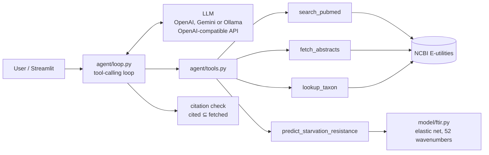

# FTIR Research Agent

An LLM agent that answers research questions about *Drosophila* stress physiology and
infrared spectroscopy from **real PubMed abstracts with checked citations**, and can run
the FTIR → starvation-resistance model from my MSc dissertation on uploaded spectra,
explaining each prediction by spectral band.

The tool-calling loop is written by hand (~100 lines, no agent framework), and the agent
is scored by an evaluation harness of 25 questions.

<!-- Demo GIF: record with the Streamlit app, save as docs/demo.gif -->

## What it does

Ask *"Which metabolic reserves explain evolved starvation resistance in Drosophila?"* and
the agent searches PubMed, reads the abstracts, and answers with inline `[PMID:…]`
citations. Every citation is then checked automatically: the app flags any PMID the model
cites without having fetched its abstract in that turn.

Load an FTIR spectrum and ask *"How starvation resistant is this line, and why?"* and it
runs the trained elastic net, then reports the prediction, which bands drove it (for
example the ester C=O stretch at ~1740–1760 cm⁻¹ from triglycerides), and the model's
documented limitations.

## Architecture



| Tool | Source | Returns |
|---|---|---|
| `search_pubmed(query)` | NCBI ESearch + ESummary | PMIDs with titles, journals, years |
| `fetch_abstracts(pmids)` | NCBI EFetch | Titles + abstracts (the only citable source) |
| `lookup_taxon(name)` | NCBI Taxonomy | taxid, rank, lineage; flags ambiguous names |
| `predict_starvation_resistance(dataset)` | Dissertation model | Prediction, band contributions, warnings, model card |

**How the loop works** (`agent/loop.py`): send the system prompt, question and tool
schemas → if the model returns tool calls, run them and append the results as `tool`
messages → repeat until it returns plain text, or until 8 rounds, after which it must
answer without tools. The assistant message is echoed back verbatim, because Gemini 3
attaches signatures to tool calls that must round-trip.

**Why the explanations are exact**: the model is linear on standardised inputs, so each
prediction is precisely `intercept + Σ coef_j · z_j`. Summing those terms per spectral
band gives the explanation, with no SHAP or other approximation needed. A unit test checks
that the bands add back up to the prediction.

## The model

From my dissertation (MSc Bioinformatics, Edinburgh Napier University, 2026). ATR-FTIR
spectra of female flies from 108 DGRP lines, averaged per line, are used to predict
starvation resistance (line EMMean from a parametric survival model). Elastic net with
nested leave-one-line-out CV: **R² = 0.673**. The refit model uses 52 of 1,723 wavenumbers,
mostly the ester carbonyl band (1706–1760 cm⁻¹), plus 3464–3478, ~1014 and ~810 cm⁻¹.

The model card the agent must report includes the dissertation's negative results. The
model did not transfer to the same trait measured in another lab, and it showed no signal
for ~30 other DGRP phenotypes. The agent is instructed never to present a prediction as a
measurement.

## Evaluation

`eval/questions.jsonl` holds 25 questions in four categories:

| Category | n | What it tests |
|---|---|---|
| literature | 16 | Facts from specific papers (key PMIDs and reference answers written from the abstracts) |
| taxonomy | 4 | Exact NCBI facts, including an ambiguous common name ("fruit fly" → 4 taxa) |
| model | 3 | Calling the model, reporting bands and limitations, comparing samples |
| negative | 2 | A non-existent study and an out-of-scope request (should decline, not invent) |

**Metrics.** Automatic, with no LLM involved:
- *citation exists*: the PMID is a real PubMed record
- *citation grounded*: its abstract was fetched in that run
- *key paper retrieved*: a known key paper was fetched
- *required facts*: keyword groups from the reference answer appear in the answer

**LLM-judged** (I say which, because it matters):
- *citation supported*: does the abstract support the sentence that cites it?
- *accuracy*: 0/1/2 against the reference answer

The judge is an LLM and can be wrong, so I hand-checked a random sample of its verdicts
and report the agreement below.

### Results

Agent and judge: `gpt-6-luna` (OpenAI), one run, 25 questions. A full run costs about
$0.10. Full per-question table: [`eval/results.md`](eval/results.md).

| Slice | n | Citations exist | Citations grounded | Citations supported (judge) | Key paper retrieved | Required facts | Fully correct (judge) |
|---|---|---|---|---|---|---|---|
| **all** | 25 | **100%** (25/25) | **100%** (25/25) | **84%** (21/25) | 75% (12/16) | 86% | **76%** (19/25) |
| literature | 16 | 100% | 100% | 83% | 75% | 81% | 62% (10/16) |
| taxonomy | 4 | 100% | 100% | 100% | n/a | 92% | 100% |
| model | 3 | n/a | n/a | n/a | n/a | 100% | 100% |
| negative | 2 | n/a | n/a | n/a | n/a | 100% | 100% |

**What the numbers say:**
- **No fabricated citations.** Every cited PMID is real, and every one was fetched and
  read in that run. Neither trap question (a non-existent study, an out-of-scope request)
  produced invented content.
- **The remaining citation issues are overstatement, not invention.** All 4 non-supported
  citations were rated PARTIAL: the claim went somewhat beyond the abstract.
- **Failures are retrieval failures.** In the 3 questions scored 0, the agent wrote long,
  over-specific PubMed queries ("…205 lines Freeze 2…"). PubMed ANDs every term, so these
  returned nothing or the wrong papers. The agent then correctly said it could not find
  the evidence rather than guessing, but the answer was still unhelpful. Short queries
  find all of these papers.

**Judge reliability.** A model from a different family (Claude, Anthropic) independently
reviewed all 25 citation verdicts ([`eval/judge_audit.md`](eval/judge_audit.md)). It agreed
with the judge on **21/25 (84%)**. The judge was too strict on 3 grouped citations, where
co-cited papers each covered part of the sentence, and too lenient on 1, where an abstract
reported obesity only for a double mutant. With the second reviewer's verdicts, citation
support is 23/25 (92%). The judge also changed one verdict between runs.

I then spot-checked 10 verdicts by hand against the abstracts: the 4 disagreements plus 6
both models called supported. I sided with the second reviewer on all 4 disagreements and
found nothing either model missed in the other 6 (human–judge agreement 6/10, human–second
reviewer 10/10). Three of the judge's four errors are the same mistake: it marks a grouped
citation down because one paper doesn't cover the whole sentence. That is a prompting
problem, not random noise. The spot-check also found two small overstatements the judge
didn't flag: the agent said a 2019 paper's authors called larger datasets "needed" where the
abstract says improvements are "possible".

**Two harness bugs found while validating the eval.** (1) Citations placed after the full
stop ("…claim. [PMID:x]") were split away from their claim, so the judge saw an empty
claim and marked correct citations unsupported. This took support from 72% to 84% once
fixed. (2) The judge sometimes returned two verdicts for one citation; scoring now keeps
one per cited paper (the stricter). Both have regression tests.

## Running it

```bash
python3 -m venv .venv && .venv/bin/pip install -r requirements.txt
cp .env.example .env          # add a free Gemini key from https://aistudio.google.com/apikey

# Optional: retrain the model (needs the dissertation FTIR data, not included)
.venv/bin/python scripts/train_model.py --data-dir /path/to/FTIRproject

.venv/bin/streamlit run app.py                       # demo
.venv/bin/python -m agent "What is the DGRP?"        # CLI
.venv/bin/python -m pytest                           # tests (no key or network needed)
.venv/bin/python eval/run_eval.py                    # evaluation (resumable)
```

Docker: `docker build -t ftir-agent . && docker run -p 8501:8501 --env-file .env ftir-agent`

Fully local and free: install [Ollama](https://ollama.com), `ollama pull qwen2.5:7b`, and
set `LLM_BASE_URL=http://localhost:11434/v1`, `LLM_MODEL=qwen2.5:7b` in `.env`.

**Data:** the FTIR spectra belong to the Dobson lab (University of Glasgow) and are not
redistributed; `model/artifacts/` and `model/examples/` are gitignored. Without them, the
literature and taxonomy tools still work, and the model tests run on a synthetic model.

## Limitations and what I'd do next

- **Query formulation is the weakest link.** Next step: have the agent start with 3–5 key
  terms and broaden on zero hits, then measure it on a *new* question set. Tuning against
  these 25 questions would overfit them.
- **The judge's citation check needs better inputs.** It doesn't apply the grouped-citation
  rule, and it only sees the sentence holding the citation. When one citation at the end of a
  paragraph covers earlier uncited sentences, those claims go unchecked. Next step: state the
  rule in the judge prompt, give it every co-cited abstract together, and pass the whole
  cited paragraph. Then re-measure agreement against the hand-checked verdicts.
- **The agent and the judge are the same model.** It may go easy on its own style of answer.
  Next step: judge with a different model family.
- **The judge runs at the model's default temperature** (gpt-6-luna only accepts its default
  temperature), so its verdicts can vary between runs.

- **The judge is an LLM.** It can be wrong, so its verdicts were partly hand-audited. Next
  steps: a second judge model, and more human-labelled verdicts.
- **Abstracts only.** Claims supported only in a paper's full text are invisible to the
  agent. Next step: PubMed Central full text for open-access papers.
- **25 questions is small.** Differences of a few points between models are not
  meaningful. Next step: more questions, with confidence intervals.
- **Free-tier rate limits** make the eval slow and limit repeated runs, so the results are
  a single run at temperature 0.
- **The model is single-lab and trained on line means.** The dissertation showed it does
  not generalise across labs. Next step: train across populations and labs, as the
  dissertation proposes.
